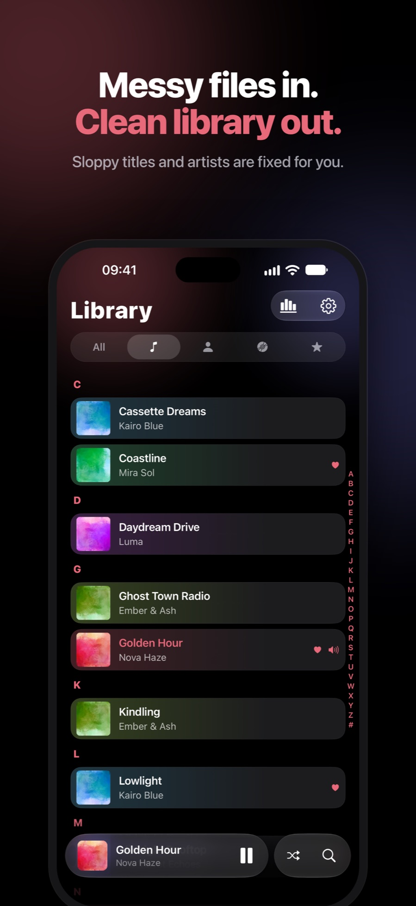
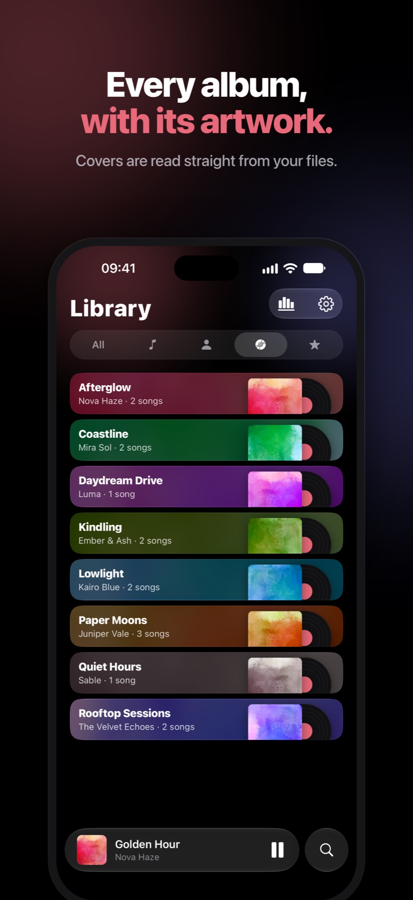

# Lucid

### Local Audio Player.

**Your music. 100% offline.**

No account. No tracking. No streaming.

  

---

## ✨ Glance at Lucid

  
  
  
  
  

---

## 🎧 Features

**Your library**

- **Private by design:** no account, no analytics and no ads. The App Store build makes no network calls, so everything stays on your device.
- **Your own files:** import single songs or whole folders from the Files app or iCloud Drive, including MP3, M4A, AAC, FLAC, WAV and AIFF.
- **Artwork that just shows up:** embedded covers are read from every common format, even huge ones.
- **Song Info:** edit title, artist, album and artwork. Changes go into Lucid's own copy of the file, so your original stays untouched.
- **Playlists:** build your own with custom covers, or let Favorites, On Repeat, Recently Added and Heavy Rotation fill themselves.
- **Tidy up:** find duplicates, clean up songs you no longer need and see what takes up storage.

**The player**

- **One screen, three modes:** Player, Lyrics and Up Next share one screen, with a single artwork gliding between them.
- **Lyrics:** follow synced lyrics and tap a line to jump there. Import `.lrc` or `.txt` files, or time them yourself line by line.
- **Up Next:** tap to play, drag to reorder and swipe to remove, with Undo.
- **Fine scrubbing:** drag down while scrubbing for half, quarter or fine speed, with a haptic tick per step.
- **Seamless playback:** choose gapless or crossfaded transitions, with instant lock-screen skips, a sleep timer and a pause when your AirPods come out.

**Your listening**

- **Replay:** your month in music at a glance, ready to share as an image, plus your listening stats.

**Made for iOS**

- **Native feel:** Liquid Glass on iOS 26+, native context menus, haptics and an accent color the whole app follows.
- **iPhone Duo:** layouts made for the big inner display.
- **Accessible:** Dynamic Type up to the largest sizes, VoiceOver labels, Increase Contrast and Reduce Motion.

---

## 🛠️ Tech Stack

| Layer | Choice |
| --- | --- |
| App | React Native 0.86 · Expo SDK 57 · TypeScript · React Compiler |
| Navigation | Expo Router |
| State | Zustand |
| Storage | `expo-sqlite` for library, playlists, lyrics and stats |
| Audio | `expo-audio` with two player slots for crossfade, patched for instant lock-screen updates |
| Motion | Reanimated 4 · Gesture Handler |
| Native | Swift modules for lock-screen remote commands, UIKit context menus and atomic tag writing (AVFoundation passthrough) |

**Built for large local libraries:**

- **SQLite as the single source of truth:** normalized search columns and indexes mean search and A–Z jumps never scan files.
- **Fixed-height rows:** lists use `getItemLayout`, so jumping to any letter never has to measure rows.
- **Lazy native menus:** a row holds one lightweight native view, and its menu is built only when it opens.
- **UI-thread animation:** transitions run as Reanimated worklets and favor transforms and opacity over layout.
- **Pre-decoded artwork:** the next and previous covers are decoded ahead of time for the lock screen.

---

## ☕ Support

Lucid is an indie app: free, with no ads, no subscriptions and no data collection.
If it makes your music feel a little better, you can buy me a coffee:

 

  

Made with care for people who still own their music.

