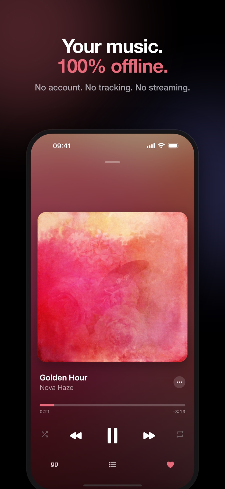
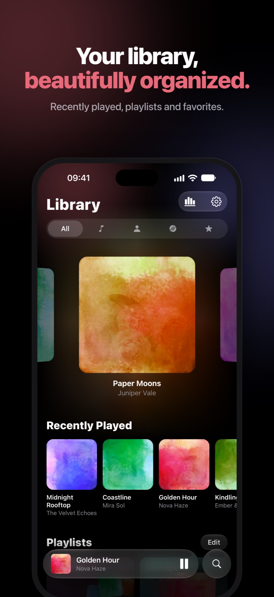
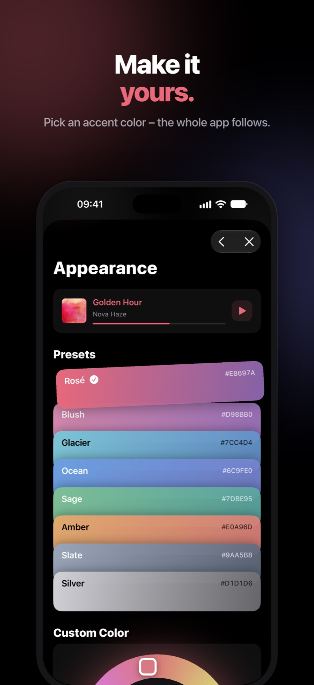
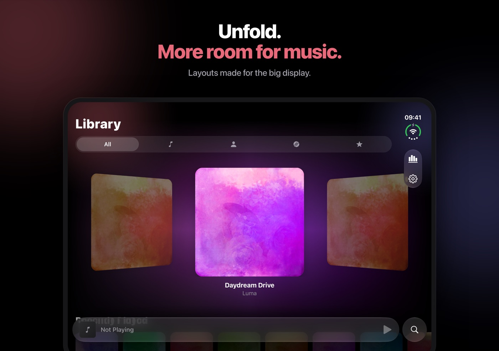
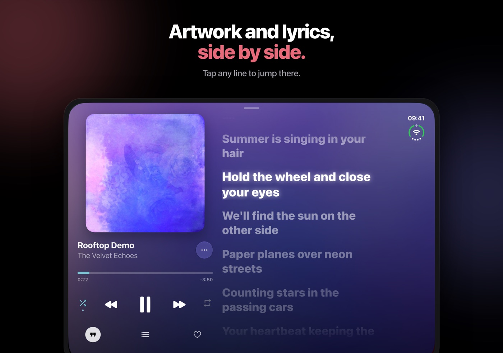

# Lucid

A private music player for the files you own.

No account. No tracking. No streaming.

 

## Features

- **Private:** No account, analytics or ads. Works fully offline.
- **Your files:** Import songs or folders from Files or iCloud Drive, including MP3, M4A, AAC, FLAC and WAV.
- **Lyrics:** Follow synced lyrics and tap a line to jump. Import `.lrc` or `.txt` files, or time them yourself.
- **Player:** Player, lyrics and Up Next share one screen, with fine scrubbing.
- **Playback:** Gapless or crossfaded transitions and a sleep timer.
- **Library:** Smart playlists, duplicate detection and Song Info editing that leaves your original file untouched.
- **Replay:** Your month in music, ready to share as an image.
- **Accessibility:** Dynamic Type, VoiceOver, Increase Contrast and Reduce Motion.

## iPhone Duo

Layouts made for the big inner display.

## About this repository

This repository hosts the Lucid website. The app itself is closed source.

Lucid is built with React Native, Expo, TypeScript, SQLite and Reanimated, with native Swift modules.

## Support

Lucid is free, with no ads or subscriptions. Requires iOS 16.4 or later.

If you enjoy it, you can [buy me a coffee](https://buymeacoffee.com/viktxrr).
